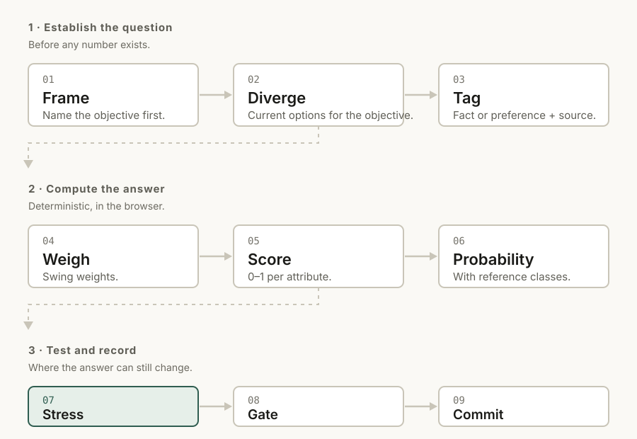
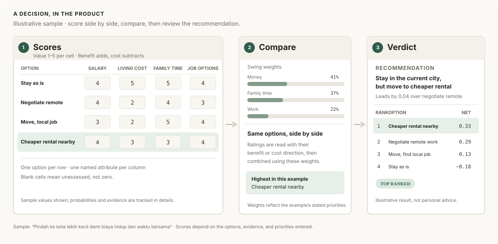

# Nimbang

A decision-making framework, implemented as software.

Nimbang guides a decision through objectives, options, trade-offs, uncertainty,
sensitivity analysis, and a record of predictions for later review.

> **Status: v0.1.0 released.** The core engine (`src/core/`) implements all
> nine stages, with a React interface in `src/ui/`.

## How it works, in one picture

Nine stages, three phases. The first phase fixes the question before any number
exists; the second computes an answer; the third tests whether that answer
survives being wrong and records it for later.



**Why the order matters.** Each stage removes a way the decision can be wrong,
and most of them are cheap:

| # | Stage | The mistake it prevents |
|---|---|---|
| 01 | **Frame** | Choosing between options before knowing what you want |
| 02 | **Diverge** | A false choice between two options, with "do nothing" never considered |
| 03 | **Tag** | An opinion written down in the grammar of a fact |
| 04 | **Weigh** | Treating every objective as equally important |
| 05 | **Score** | Winning by having more items listed, rather than better ones |
| 06 | **Probabilify** | A probability that names no reference class — a feeling with a decimal point |
| 07 | **Stress** | Trusting a ranking that one wrong input would reverse |
| 08 | **Gate** | Skipping the reflection questions, because they are never required |
| 09 | **Commit** | Never finding out whether the reasoning was any good |

## Why not just a pros/cons calculator

A pros/cons list counts. It cannot tell you how much each line matters, and it
cannot tell you how confident to be in the total.



Nimbang adds three things:

- **Weights that mean something.** Objectives are compared by *swing* — how much
  it matters to move from the worst option to the best on that objective — not by
  asking "how important is this", a question everyone answers 5.
- **It tells you when the answer is fragile.** A ranking built on subjective
  scores is only as good as its inputs. Nimbang reports which single input, if
  wrong, flips the decision — so you know which uncertainty is worth
  investigating first.
- **It closes the loop.** Decisions are recorded with their predicted
  probabilities and reviewed later with a calibration score. Being wrong on
  schedule is how the next decision gets better.

## The pipeline in detail

Every stage is a pure function over plain data. The formal definitions, formulas,
and the source behind each method are in [`docs/framework.md`](docs/framework.md);
citations are in [`docs/references.md`](docs/references.md).

| Stage | What happens | Grounded in |
|---|---|---|
| Frame | State objectives before listing options | Keeney, *Value-Focused Thinking* |
| Diverge | Require at least three options, including "do nothing" | against false dichotomy |
| Tag | Mark every claim as fact or preference | Hume's is–ought gap |
| Weigh | Weight objectives by swing, not by "importance" | MAVT / swing weighting |
| Score | Value each option on each named attribute, normalised 0–1 | additive value function |
| Probabilify | Attach probabilities and reference classes | expected value |
| Stress | Tornado, break-even, Monte Carlo | sensitivity analysis |
| Gate | Reflection prompts that target specific biases | Klein, Flyvbjerg, Arkes |
| Commit | Lock the decision and its predictions; review on schedule | Brier score |

A recommendation is withheld until the inputs are complete: every claim tagged,
every probability carrying a reference class, and every option assessed on every
attribute. A blank cell counts as unassessed, not as zero.

## Design constraints

- **Deterministic core, thin optional backend.** All scoring, sensitivity, and
  calibration run in the browser on plain data — `src/core/` is pure and needs
  no server. A backend exists for exactly one reason: a model API key cannot
  live in a browser. That backend is one endpoint, not a service.
- **The engine is pure.** `src/core/` holds functions with no framework imports,
  so the mathematics is testable on its own and reusable outside the UI.
- **Every number is traceable.** The app must always be able to say where a
  score came from and what would change it. A model-derived number is labelled
  with its source and confidence, and is overridable.

## Structured input

The optional **elicitation panel** helps turn a description into structured
fields. It asks what you are considering and proposes options for you to accept.
It does not make the decision.

**The model fills fields; the engine computes.** The panel does not receive
scores, weights, or probabilities. It works with any OpenAI-compatible gateway —
see [`docs/llm-providers.md`](docs/llm-providers.md).

## Repository layout

```
docs/
  framework.md              the framework itself: stages, formulas, citations
  references.md             verified sources for every method the engine uses
  core-engine-scope.md      what ships, what is excluded, and why
  llm-providers.md          configuring the panel for any OpenAI-compatible gateway
  how-to-use.md             a worked example with a share link
  images/                   the diagrams in this README, as SVG
  sources/                  extracted notes (page photos are never committed)
  superpowers/specs/        design documents
  superpowers/plans/        implementation plans
DESIGN.md                   design tokens and rationale (Google DESIGN.md spec)
examples/                   two complete decisions, runnable as share links
src/core/                   pure decision engine, no UI imports
src/ui/                     dashboard, workspace, panels, stylesheet
tools/vision/               research tooling: page photo -> text
tools/eval/                 browser checks for the built app (not in CI)
```

## Local setup

```bash
pnpm install
pnpm test        # core engine, UI, and integration tests
pnpm build       # tsc --noEmit, then a production bundle
pnpm dev         # the app, at http://localhost:5199
git config core.hooksPath .githooks   # one time per clone; blocks page photos
```

New to it? [`docs/how-to-use.md`](docs/how-to-use.md) walks through a worked
example with a share link you can paste in.

### AI suggestions (optional)

The app works without a model. To enable suggestions, configure a chat model with
tool calling through any OpenAI-compatible gateway:

```bash
cp .env.example .env    # set LLM_BASE_URL and LLM_API_KEY for your gateway
pnpm dev
```

`LLM_BASE_URL` is the gateway's API base URL, including its version path (for
example, `https://api.openai.com/v1` or `https://api.groq.com/openai/v1`). It
does not have to be Kenari. Set `LLM_API_KEY` to the matching key; leave
`LLM_MODEL` blank to try model discovery. The Kenari-specific
`KENARI_API_KEY` is an optional fallback that uses Kenari's URL when the explicit
`LLM_BASE_URL`/`LLM_API_KEY` pair is not configured.

Without a key the endpoint returns `503 not_configured` and the panel says so —
the panel does not silently do nothing. Provider examples and gateway-specific
settings: [`docs/llm-providers.md`](docs/llm-providers.md).

## License

MIT. See [`LICENSE`](LICENSE).

## Acknowledgements

Built on published decision science. Full citations in
[`docs/framework.md`](docs/framework.md).
